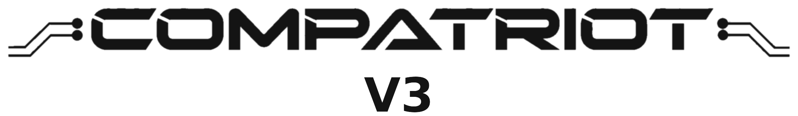
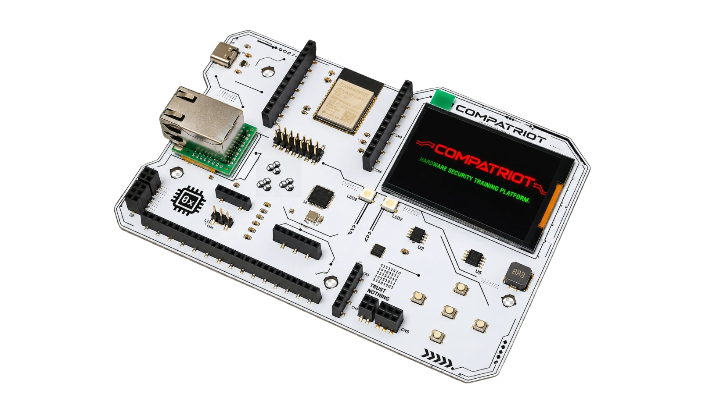

<div align="center">

<picture>
  <source media="(prefers-color-scheme: dark)" srcset="hardware/images/compatriot_logo_white.png">
  
</picture>



**The Compatriot hardware security badge.** Pre-built firmware, full hardware
reference, and player guides for every challenge.

[](firmware)
[](challenges)
[](challenges)
[](hardware)
[](LICENSE)

</div>

---

## What is Compatriot?

Compatriot is a self-contained, offline hardware security training badge. It's a
physical, hands-on counterpart to the usual software-only CTF.
Every challenge runs on real silicon, on a real bus, not a simulation: you sniff an
actual SPI/I2C/UART line with a logic analyzer, dump the badge's own external SPI
flash (W25Q64) or I2C EEPROM (M24256E) with a CH341A
programmer, reverse-engineer a real encrypted binary over SWD on a second
microcontroller, and inject real CAN frames onto a real automotive bus. Nothing
about the attack surface is faked for the exercise. The skills transfer directly to
real embedded devices and vehicles.

The board carries two independent microcontrollers on purpose. An **ESP32-C6**
(RISC-V) runs the badge's own UI, challenge logic, BLE/WiFi stack, and the
CAN-over-Ethernet bridge. A separate **STM32F103C8T6** target chip has only one job:
be a genuine reverse-engineering target. Attendees connect their own debug probe to
it over SWD and extract a flag from its firmware the same way they would on any
unknown embedded device in the field. A W5500 Ethernet module exposes a real CAN bus
(bridged over `cannelloni`) for the automotive challenges, so the UDS diagnostic and
ISO-TP tooling used here is identical to what's used against a real vehicle's OBD
port. The board also carries two expansion slots (shared I2C and SPI, independent
chip-select each) so new challenge hardware can be added in future revisions without
a new PCB.

The badge is deliberately self-contained: no backend server, no internet dependency,
no shared infrastructure that can fall over under load. Progress is scored and
persisted on the badge itself (NVS, survives a reboot), so it scales to as many
attendees and as many badges as you can physically hand out. The included
[`firmware/flash.sh`](firmware/flash.sh) script is built around exactly that:
flashing many badges, unattended, for a live event.

**18 challenges across 3 categories** (Automotive, Embedded, Wireless), each with a
guided hint and a full walkthrough, so the badge works equally well as a timed CTF
station and as a self-paced teaching tool. This repository is the complete portable
reference, firmware, hardware, and guides, needed to actually build, flash, and run
the badge.

## Contents

- [What is Compatriot?](#what-is-compatriot)
- [What's in this repo](#whats-in-this-repo)
- [Quick start](#quick-start)
- [The badge](#the-badge)
- [Categories](#categories)
- [Events](#events)
- [Repository structure](#repository-structure)
- [Roadmap](#roadmap)
- [License](#license)

## What's in this repo

| Folder | Contents |
|--------|----------|
| [`firmware/`](firmware) | Pre-built ESP32 and STM32 binaries and a one-command flash script |
| [`hardware/`](hardware) | Board photos, full schematic, 3D render, BOM, pin maps |
| [`challenges/`](challenges) | Player guides for all 18 challenges (Automotive / Embedded / Wireless) |

## Quick start

1. **Flash the badge**
   ```bash
   cd firmware
   ./flash.sh /dev/ttyACM0
   ```
2. **Connect a serial terminal** at **115200 8N1** to see the badge's own console.
3. **Open [`challenges/`](challenges)** and start solving. The badge screen itself
   also shows each challenge's objective and wiring.

Building a badge from scratch also needs the STM32 target chip flashed once, see
[`firmware/stm32_target/`](firmware/stm32_target).

## The badge

| | |
|---|---|
| **MCU** | ESP32-C6-WROOM-1 (RISC-V), 4 MB flash |
| **Secondary target** | STM32F103C8T6, SWD-debuggable over header H3 |
| **Network** | W5500 Ethernet module, speaks `cannelloni` (CAN-over-UDP) for Automotive. Onboard BLE and WiFi for Wireless. |
| **Display** | 320×240 LCD, 5-button navigation |
| **Challenges** | 3 categories, 18 challenges, 2875 total points |
| **Expansion** | 2 module slots (I2C + SPI + power, independent chip-select each) |

The board is built to grow. Two onboard expansion slots expose a shared I2C bus and
a shared SPI bus, each with its own independent chip-select, so future challenge
hardware can plug straight in rather than needing a new PCB revision. See
[`hardware/README.md`](hardware/README.md#expansion-ports) for the full pinout.

See [`hardware/README.md`](hardware/README.md) for the full pin map, schematics, 3D
render and bill of materials.

## Categories

| Category | Challenges | Points | Guide |
|----------|:---:|:---:|-------|
| Automotive (CAN bus and UDS over Ethernet) | 5 | 1150 | [`challenges/automotive.md`](challenges/automotive.md) |
| Embedded (hardware peripherals) | 8 | 925 | [`challenges/embedded.md`](challenges/embedded.md) |
| Wireless (BLE / WiFi) | 5 | 800 | [`challenges/wireless.md`](challenges/wireless.md) |

## Events

| Event | Date | What was shown |
|-------|------|-----------------|
| Black Hat Asia 2025, Arsenal Labs | April 2025 | CompatrIoT (an earlier edition) |
| SINCON, Infosec in the City (Hardware Hacking Kampung) | 2025 | CompatrIoT (an earlier edition) |
| CODE BLUE, Japan | 2025 | CompatrIoT (an earlier edition), workshop and CTF |
| BSides Kerala | 2025 | CompatrIoT (an earlier edition), hardware hacking training |
| BSides Kerala | 2026 | CompatrIoT (an earlier edition), hardware hacking training |
| Black Hat Arsenal Labs, India 2026 | 2026 | This build (Compatriot V3) |
| CODE BLUE, Japan | 2026 (selected) | This build (Compatriot V3) |

## Repository structure

```
ComparIoT_V3/
├── firmware/              pre-built binaries, ready to flash
│   ├── compatriot_merged.bin   ESP32 firmware (the badge itself)
│   ├── stm32_target/           STM32 firmware for Target Acquired
│   ├── flash.sh
│   └── README.md
├── hardware/              board reference
│   ├── images/            board photo, header/ethernet close-ups, 3D render
│   ├── schematics/        full schematic PDF + annotated crops
│   ├── bom.csv            full bill of materials
│   └── README.md
└── challenges/            player guides, one file per category
    ├── automotive.md
    ├── embedded.md
    ├── wireless.md
    └── README.md
```

## Roadmap

Compatriot is still an active build. Planned directions for future revisions:

- More SWD challenges beyond Target Acquired: multiple target chips, protected
  debug regions, and recovering firmware behind a locked debug port instead of an
  open one.
- Dedicated JTAG challenges, separate from the SWD-based ones that exist today, on
  a chip where JTAG is the only available debug interface.
- Side-channel challenges: timing and power-based analysis against one of the
  badge's own chips, not just bus sniffing and firmware dumps.
- Reimplementing some of the earlier automotive concept challenges (archived in the
  main project, not shipped on this badge yet) against the live CAN bus instead of
  as flag-only exercises.
- Ethernet-based challenges, using the onboard W5500 for more than just the CAN
  bridge it runs today.
- Zigbee challenges, using the ESP32-C6's own built-in 802.15.4 radio (the same
  chip already does WiFi and BLE), no extra hardware needed.

This list reflects current plans, not shipped features. The 18 challenges described
above are what the badge actually runs today.

## License

See [LICENSE](LICENSE). Non-commercial use only: individuals, researchers, and
educators are free to use, flash, and adapt this, but not to sell it or build a
commercial product on top of it without permission.
