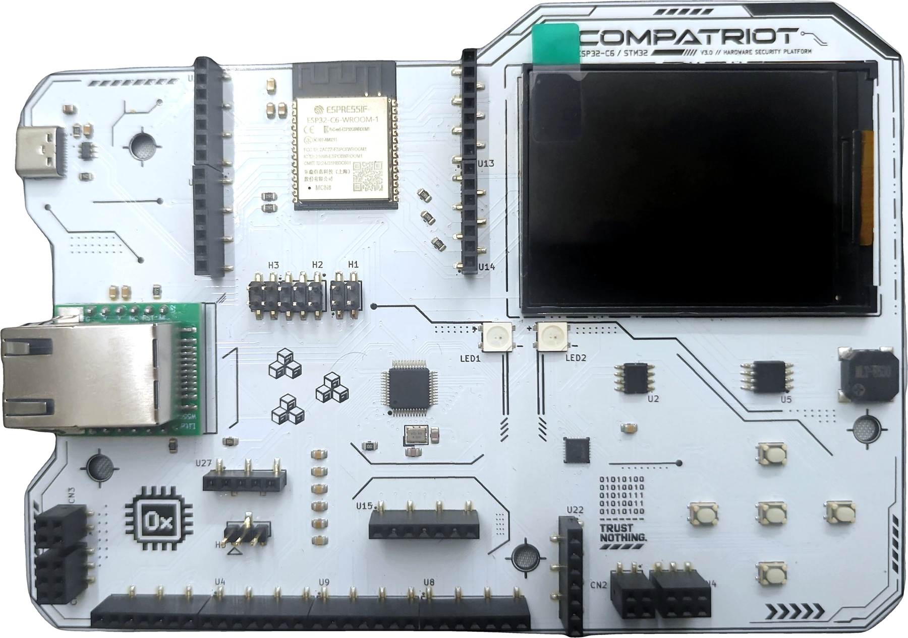

# Hardware

The Compatriot badge is an ESP32-C6-WROOM-1 (RISC-V) board with a secondary
STM32F103C8T6 target chip, a W5500 Ethernet module for CAN-over-Ethernet, and a set
of breakout headers for the hardware challenges.

  

## Contents

- [Images](#images)
- [Schematics](#schematics)
- [Key components](#key-components)
- [Pin map](#pin-map)
- [Expansion ports](#expansion-ports)
- [Full bill of materials](#full-bill-of-materials)

## Images

| File | What it shows |
|------|----------------|
| [`images/board.webp`](images/board.webp) | Full board, top view |
| [`images/headers.jpg`](images/headers.jpg) | Close-up of the H1/H2/H3 and U10/U11/U13/U14 breakout headers |
| [`images/ethernet.jpg`](images/ethernet.jpg) | The RJ45 (W5500) Ethernet jack used for the CAN bridge |
| [`images/pcb_render.png`](images/pcb_render.png) | 3D render of the bare PCB layout, from the KiCad source |

## Schematics

| File | What it shows |
|------|----------------|
| [`schematics/full_schematic.pdf`](schematics/full_schematic.pdf) | Complete schematic, exported straight from the board's KiCad source |
| [`schematics/headers.jpg`](schematics/headers.jpg) | Crop: breakout header pin numbers and net names |
| [`schematics/eeprom_flash.jpg`](schematics/eeprom_flash.jpg) | Crop: external I2C EEPROM (U2) and SPI flash (U5) |
| [`schematics/io.jpg`](schematics/io.jpg) | Crop: free/expansion GPIOs used by the sniffing challenges |

## Key components

| Ref | Part | Function |
|-----|------|----------|
| U3 | ESP32-C6-WROOM-1-N8 | Main MCU: badge UI, challenge logic, BLE/WiFi, CAN bridge. Also has a built-in 802.15.4 radio (Zigbee/Thread), not used by any challenge yet. |
| U7 | STM32F103C8T6 | Secondary SWD-debuggable target chip (Target Acquired challenge) |
| RJ1 | WIZ850IO (W5500) | Ethernet-to-SPI bridge, speaks `cannelloni` (CAN-over-UDP) |
| U2 | M24256E-FMN6TP | External I2C EEPROM, 32 KB, addr `0x50` |
| U5 | W25Q64JVSSIQ | External SPI NOR flash |
| U24 | AW9523BTQR | I2C GPIO/button expander, addr `0x58` |
| U1 | USBLC6-2SC6 | USB-C ESD protection |
| U6, U12 | AP2114H-3.3TRG1 | 3.3 V LDO regulators |
| J1 | USB Type-C | Power + USB-CDC serial |
| U4, U8–U11, U13–U15, U22, U25 | 1×7 female headers | Breakout headers for the challenges |
| U27 | 1×5 female header | Auxiliary breakout |
| SW1–SW4 | Tactile switches | BOOT / RESET |

Full reference designators and quantities for every part (passives included) are in
[`bom.csv`](bom.csv).

## Pin map

| Signal | GPIO | Header / location |
|--------|------|--------------------|
| I2C_SDA / I2C_SCL | IO21 / IO22 | U14 pins 5 / 6 |
| UART0 TX (leak) | IO16 | U13 pin 4 (net `TX_ESP32`) |
| SPI sniff SCK / MOSI / CS | IO2 / IO3 / IO15 | U13 pins 6 / 5 / 2 |
| SPI flash (W25Q64) SCK/MOSI/MISO/CS | IO20 / IO18 / IO19 / IO0 | shared display bus |
| STM32 SWD (onboard DAP) | SWDIO=IO4, SWCLK=IO6 | shared with JTAG header |
| STM32 target SWD (H3) | SWDIO=PA13, SWCLK=PA14, NRST, GND | H3 |
| NeoPixel | IO10 | — |
| Buzzer | IO11 | — |

GPIO4/5/6/7 on the ESP32 are wired to the onboard SWD/JTAG debug link to the STM32
target, so don't reuse them for anything else, they'll fight the debug interface.
This is exactly why the SPI-sniff CS line lives on IO15 and not IO4.

## Expansion ports

The board is built to be extended. Two identical module slots are broken out as
header pairs:

| Slot | Headers | Pins | Signal |
|------|---------|------|--------|
| 1 | CN1 + CN3 | I2C_SDA, I2C_SCL, SPI_CLK, MOD1_CS, SPI_MOSI, SPI_MISO, 3.3 V, VUSB, GND | independent chip-select (`MOD1_CS`) |
| 2 | CN4 + CN2 | I2C_SDA, I2C_SCL, SPI_CLK, MOD2_CS, SPI_MOSI, SPI_MISO, 3.3 V, VUSB, GND | independent chip-select (`MOD2_CS`) |

Both slots share the same I2C bus and the same SPI clock/MOSI/MISO lines (the same
bus the onboard flash, EEPROM, and Ethernet module sit on), but each gets its own
dedicated chip-select, so a plugged-in daughter board can be addressed on either bus
without colliding with anything already on the board. This is how new challenge
hardware gets added to future revisions without redesigning the PCB: a new sensor,
chip, or protocol target plugs straight into slot 1 or slot 2.

## Full bill of materials

[`bom.csv`](bom.csv) is exported directly from the KiCad schematic (grouped by value +
footprint) and lists every part on the board, passives included.
